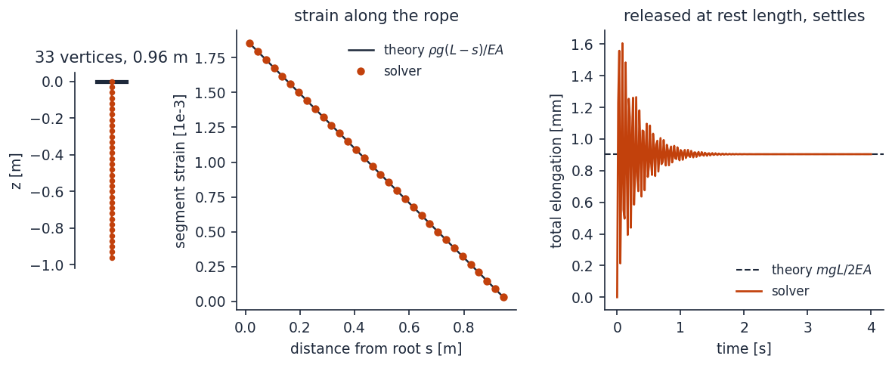
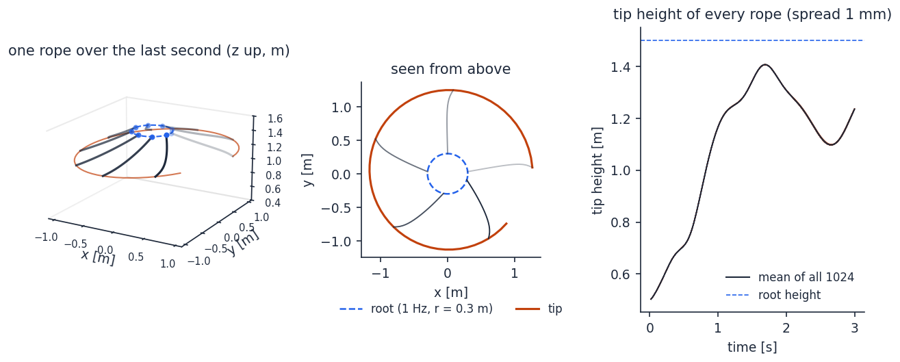
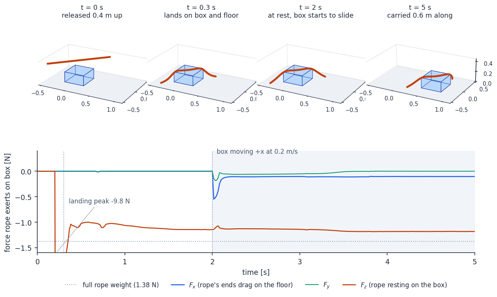
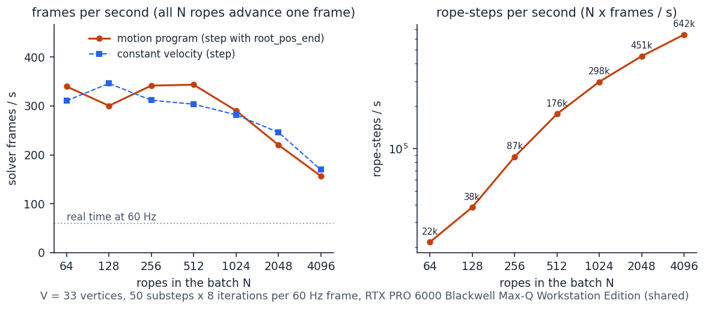
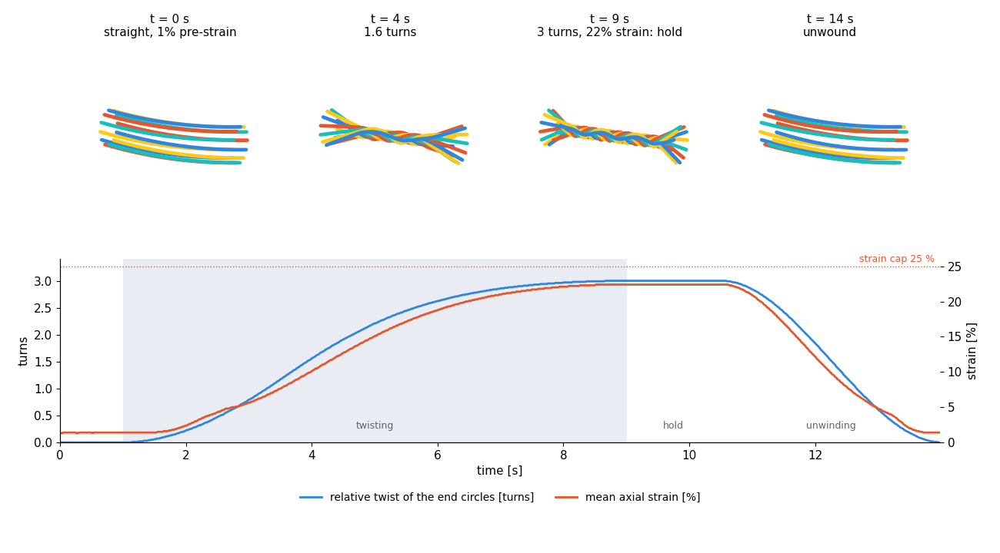
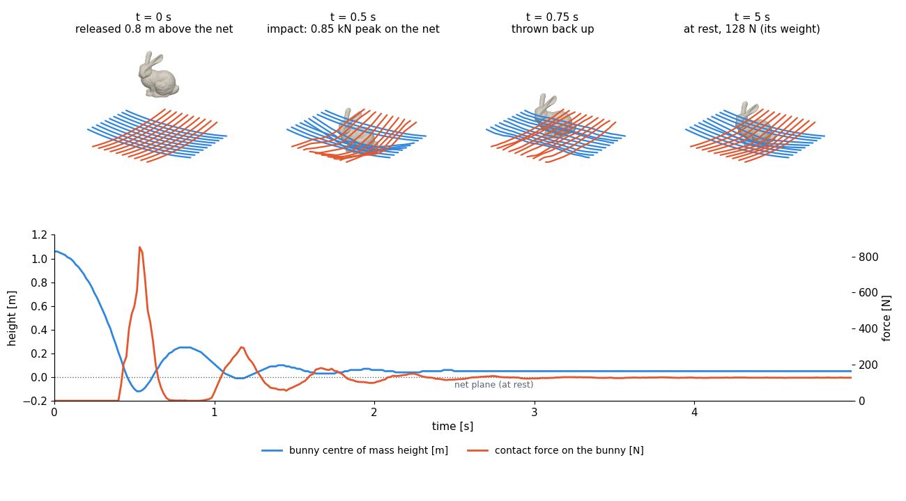
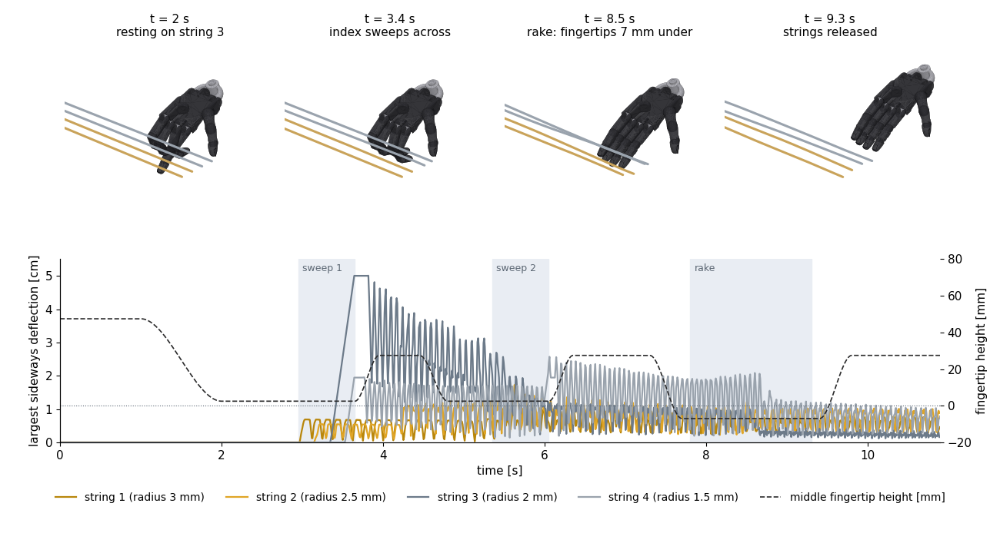

# Examples

Seven standalone rope simulations. They need only `ropesim` and a CUDA GPU, not Isaac Sim.
Build and install the package first (see the [top-level README](../README.md)), then run them
from the repository root. The first four finish in a few seconds and check the solver against
theory; the three showcase scenes run for minutes and each write a standalone HTML player.

| Script | What it shows |
|---|---|
| [`hanging_rope.py`](hanging_rope.py) | One rope (`RopeSim`) settles under gravity; its stretch matches theory |
| [`batch_swing.py`](batch_swing.py) | 1024 ropes in one `RopeBatch`, roots driven from CUDA tensors |
| [`mesh_contact.py`](mesh_contact.py) | Rope on a box and the floor: mesh and plane contact, friction, force readout |
| [`throughput.py`](throughput.py) | Solver frames per second as the batch grows |
| [`twist.py`](twist.py) | 12 pre-tensioned ropes twisted into a bundle by counter-rotating end circles, held, unwound: rope-rope contact under tension |
| [`net.py`](net.py) | A 10 × 10 rope net catches the Stanford bunny, a free rigid body driven by the wrench the solver reports |
| [`strings.py`](strings.py) | A Shadow Hand plucks and rakes four pre-tensioned strings; every hand link is a kinematic signed-distance grid |

Units are SI throughout: density ρ in kg/m, `k_stretch` = EA in N, `k_bend` = EI in N·m²,
`drag` in 1/s. Every example sets `damping = 0`. YarnBall's internal damping brakes each
vertex's absolute velocity, not just deformation, so physical dissipation comes from `drag`
alone ([docs/SOLVER.md](../docs/SOLVER.md), section 3).

## Hanging rope

```bash
python examples/hanging_rope.py            # add --plot to draw the settled rope
```



A 0.96 m rope with 33 vertices hangs from a fixed root. It starts at its rest length, bounces
along its axis, and settles within about two seconds under heavy air drag. Each segment
carries the weight of the rope below it, so its strain falls linearly from root to tip,
ε(s) = ρ g (L − s) / EA. Summed over the rope, the total elongation is m g L / 2EA. The
solver's per-segment strain lies on that line, and its total elongation matches to four digits:

```
rest length 0.960 m, settled length 0.96090 m
elongation 9.041e-04 m, theory m g L / (2 EA) = 9.041e-04 m
```

## Many driven ropes

```bash
python examples/batch_swing.py --num_ropes 1024 --seconds 3
```



1024 ropes, each 1 m long with the properties of a 12.7 mm braided nylon rope, live in one
`RopeBatch`. Each root is pinned and moved around a 0.3 m circle at 1 Hz. This is the pattern
an RL environment uses. Every frame passes the root's position and velocity at the frame start
and its position at the frame end as CUDA tensors. The solver follows a quadratic path between
them across 100 substeps. Positions come back as a zero-copy view of the solver's buffer.

The rope spins up from hanging straight down. Its tip flies out to a circle of about 1.2 m and
climbs toward root height. All 1024 ropes get the same input, and their tip heights agree to
about a millimetre. The script prints the throughput and that spread:

```
1024 ropes x 21 vertices, 100 substeps x 8 iterations per 60 Hz frame
180 frames in 1.53 s: 117.8 frames/s, 120.6k rope-steps/s, 1.96x realtime
tip height mean 1.235 m, spread 0.0009 m (all ropes see the same motion)
```

## Contact with a box and the floor

```bash
python examples/mesh_contact.py
```



A free 1.2 m rope is released 0.4 m above the floor, across a 0.4 × 0.4 × 0.2 m box standing
on it. After two seconds the box slides +x at 0.2 m/s. The box is a signed-distance grid built with `ropesim.sdf`.
The floor is a contact plane. The script reads the force the rope exerts on the box every
half second.

- **Landing:** the rope drapes over the box with its ends on the floor. The box carries
  1.15 N of the rope's 1.38 N weight.
- **Sliding:** friction on the box top carries the rope along, and its ends drag on
  the floor. The steady backward pull on the box is the floor's kinetic friction on the ends
  plus a little air drag. The script checks the two against each other:

```
t= 5.0s  rope z in [0.0063, 0.2146] m  x mean +0.557 m  force on box (-0.104, +0.000, -1.182) N
(steady pull on the box F_x = -0.104 N; floor friction on the dragged ends plus air drag predicts -0.103 N)
```

The box is kinematic here: `set_mesh_poses` moves it every frame and the rope feels the moving
surface. To let the rope push the body back, feed the force readout to a physics engine. The
Isaac Lab bridge (`ropesim.isaac_bridge`) does that.

## Throughput

```bash
python examples/throughput.py              # N = 64 ... 2048
python examples/throughput.py 64 4096      # your own list
```



The sweep times ropes of 33 vertices at 50 substeps × 8 iterations per 60 Hz frame, and
compares two ways of driving the root:

- **constant velocity:** `step(pos, vel, ...)` sweeps the root linearly across the frame.
- **motion program:** `step(..., root_pos_end=...)` lands the root on the frame-end pose.
  It costs about the same.

Frames per second stay roughly flat up to about 1024 ropes, because the GPU is not yet full.
Past that, total work per second, in rope-steps, keeps climbing. The figure was measured on
an RTX PRO 6000 Blackwell Max-Q shared with other jobs. Expect your numbers to differ with
the GPU and its load.

## Showcase scenes

The three scenes below record a simulation and write it out as a standalone HTML player
(`twist.html`, `net.html`, `strings.html`): three.js from a CDN, the trajectory embedded as
int16, smooth tubes, a scrub bar, playback speed and a slow camera orbit. Open the file in a
browser with internet access (three.js is fetched). They share the code in [`scene/`](scene/): the player (`viewer.py`,
`viewer_core.js`), recording and pin driving (`common.py`), mesh preparation (`assets.py`)
and the Shadow Hand kinematics (`hand_export.py`). The solver environment needs `trimesh`
and `scipy` as well as `ropesim`.

Recordings and assets live in one directory, `$ROPE_DEMOS_DIR` (default `~/rope_demos`):

- `twist.html`, `net.html`, `strings.html`, each next to an `.npz` of the trajectory;
- `assets/bunny.obj`, the Stanford bunny, for `net.py`;
- `assets/shadow_hand/`, the `shadow_hand` folder of
  [MuJoCo Menagerie](https://github.com/google-deepmind/mujoco_menagerie), unmodified, for `strings.py`;
- `venv_mj/`, a Python environment with `mujoco`, `trimesh` and `scipy` in which `strings.py`
  runs `scene/hand_export.py` (`python -m venv venv_mj && venv_mj/bin/pip install mujoco trimesh scipy`).

All three set gravity explicitly (the solver's default is y-down), `damping = 0`, and small
substeps: h = 1/48000 s (twist), 1/24000 s (net), 1/96000 s (strings). On an RTX PRO 6000
Blackwell Max-Q shared with other jobs they take about 8, 5 and 12 minutes.

### Twisted cable bundle

```bash
python examples/twist.py                   # --turns, --strain_cap, --k_friction, --duration ...
```



Twelve soft ropes (ρ 0.06 kg/m, EA 120 N, radius 8 mm) run between two circles of radius
10 cm that face each other 0.8 m apart. Both ends of every rope are pinned and driven
kinematically; nothing else is drawn. The ropes start straight at 1 % pre-strain, settle under
gravity, and the circles then counter-rotate in place. Winding into a bundle makes the ropes
longer, so they stretch; the twist rate is gated by the mean strain and stops as it approaches
the 25 % cap, at three turns. The bundle holds for 1.5 s and unwinds over 3.5 s.

Rope-rope contact holds the bundle together. Its friction spring is 1e4 N/m here on
purpose: a taut bundle with a stiffer spring (1e5 N/m and above) chatters, a stick-slip
jitter that no time-step or iteration setting removes.

```
rope rest length 0.7920 m (D 0.8, slack -0.01), seg 0.0132 m, EA 120.0 N
t= 4.00s  twist 1.56 turns  strain mean 10.12% max 13.23%
t= 9.00s  twist 3.00 turns  strain mean 22.43% max 30.85%
```

### Bunny on a rope net

```bash
python examples/net.py                     # --drop, --height, --density, --exchange ...
```



Two layers of ten ropes (radius 1 cm, 2.4 m span, 14 cm spacing, one layer a diameter below
the other) are pinned at both ends and held together only by rope-rope contact and friction.
The net hangs under gravity first. A 0.75 m Stanford bunny (13 kg, density 150 kg/m³) is
released 0.8 m above it. The bunny is a free rigid body integrated by the script from the
wrench the solver reports on its signed-distance mesh; the pose/wrench exchange is sub-cycled
ten times per 60 Hz frame. The impact peaks at about 850 N, six and a half times the bunny's
weight, and it bounces twice before the net carries it. The script also samples the signed
distance of every rope vertex from the bunny surface each frame and prints the closest
approach: no rope ever gets inside its own radius.

```
bunny: 2507 verts, height 0.75 m, volume 0.0871 m^3, mass 13.07 kg
t= 0.50s  bunny z -0.097  v [-0.02 -0.06 -1.48]  F   523.7 N  rope z min -0.394  gap -0.0 mm
t= 4.75s  bunny z  0.048  v [-0.   -0.   -0.  ]  F   128.4 N  rope z min -0.251  gap -0.0 mm
closest rope-surface gap over the run: -0.0 mm (negative = penetration beyond the rope radius)
```

### Robot hand on four strings

```bash
python examples/strings.py                 # --tension, --depth, --rake_depth, --strokes ...
```



Four nylon strings (radius 3, 2.5, 2 and 1.5 mm, 0.9 m, 361 vertices each) are pinned at
both ends and tensioned to 1.6 N, so they ring at 4 to 8 Hz, a slow-motion pitch. A Shadow
Hand (MuJoCo Menagerie, unmodified) rests three fingertips on one string, sweeps its index
finger across all four twice, then straightens its fingers and rakes across with the
fingertips 7 mm below the string axes. Every hand link is a kinematic signed-distance grid of
its drawn mesh (1 mm spacing), so what touches the strings is what is drawn. Each string is
its own `RopeBatch` and collides at its own radius; the batches share the hand's grids and are
stepped in turn.

The hand motion is a small choreography in `strings.py`: a path for the lowest point of the
middle fingertip, joint keys, and fingertip targets that `scene/hand_export.py` turns into
joint angles by inverse kinematics before exporting one pose per link per frame. The rake
depth is bounded by the fingertip itself: its pad reaches 12 mm above the tip, and a string
caught above that on the joint step is dragged along instead of plucked.

```
string fundamentals [Hz]: [3.98 4.78 5.98 7.97]  pre-strain 1.00%
finger IK: worst residual 0.00 mm
  rh_mfdistal  lowest point (y, z) [mm]: rest (+13, +2.5)  mid-rake (-5, -7.0)
t= 9.00s strain mean 1.03%  max |y-dev| [0.32 0.4  0.24 1.13] cm  gap [inf inf inf inf] mm
closest string-hand gap over the run per string: [-0. -0. -0. -0.] mm (negative = inside the drawn radius)
```
